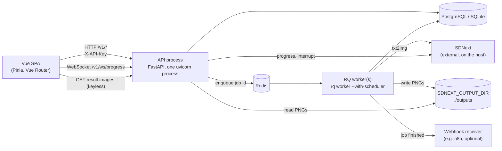

# Architecture

[← Wiki home](README.md)

## The system at a glance



Only the parts on the left are required. Redis, the worker, SDNext and the ML
stack are each optional, and the code degrades rather than failing to start:

| Missing | Effect |
| --- | --- |
| `REDIS_URL` | Jobs run inside the API process on the in-process runner, one at a time, no retries ([details](Generation-Pipeline.md#the-in-process-fallback)). |
| `SDNEXT_BASE_URL` | Generation jobs fail with a clear error; everything else works. |
| ML packages (`requirements-ml.txt`) | Recommendation endpoints return limited results; imports are lazy and guarded, so the app and tests still run. |
| `DATABASE_URL` | SQLite file `db.sqlite` in the repo root. |

In `ENVIRONMENT=production`, `DATABASE_URL`, `REDIS_URL` and `SDNEXT_BASE_URL`
are required and startup fails without them
([`config.py`](../../backend/core/config.py)).

## Processes and why there is only one API process

- **API**: exactly one uvicorn process, no `--workers`, no replicas. The
  WebSocket `ConnectionManager` and the `JobProgressMonitor` tasks live in
  module globals ([`backend/services/websocket/service.py`](../../backend/services/websocket/service.py)),
  so a second process would never see the first one's subscribers. The
  in-process job runner and `JobRecovery` also assume one API process.
- **RQ workers**: scale freely. Each runs `backend.workers.tasks.process_delivery`
  (and the recommendation tasks) against the shared database.
- **SDNext**: renders one image at a time, and its progress and interrupt
  endpoints are process-global. That is why the in-process fallback runs jobs
  strictly serially, and why live progress is only trusted for the job the
  database says is running.

## Repository layout

```
app/main.py              SPA host: mounts the backend at /api, serves dist/, /frontend/settings
app/frontend/            Vue SPA (src/, static/, containers/)
backend/
  main.py                create_app(): routers, lifespan, error handlers
  api/v1/                FastAPI routers (one module or package per area)
  core/                  config, database, migrations runner, security, logging, GPU probe
  models/                SQLModel tables
  schemas/               Pydantic request/response models
  services/              ServiceRegistry and every domain service
  delivery/              Delivery and generation backends (SDNext, HTTP, CLI), image storage
  workers/               RQ task entrypoints, DeliveryRunner, WorkerContext
  migrations/            The only Alembic tree
scripts/                 ci_check.py, importer.py, demo, bundle check, API type generation
tests/                   pytest (top level, api/, services/, …) and Vitest (vue/, integration/), Playwright (e2e/)
docs/                    Documentation, including this wiki
```

## Lifespan: what happens at startup

[`backend/main.py`](../../backend/main.py) `lifespan()` runs, in order:

1. `setup_logging()`.
2. `init_db()`: runs Alembic to `head` ([`backend/core/migrations.py`](../../backend/core/migrations.py)).
   There is no `create_all`; migrations are the only way the schema is made.
3. `ensure_delivery_system()`: registers the `http` and `cli` delivery
   backends and the `sdnext` generation backend in the process-wide registry.
   Importing `backend.delivery` registers nothing.
4. `JobRecovery.start()`: fails stuck jobs and, without Redis, requeues
   waiting ones ([details](Generation-Pipeline.md#recovery)).
5. Background task: `EmbeddingService.preload_models` in a thread (failure
   only logs).
6. Background task, if `IMPORT_ON_STARTUP`: one-shot library import from
   `IMPORT_PATH`.

On shutdown it stops job recovery, stops the in-process job runner, and waits
briefly for the startup tasks.

`app/main.py` wraps this: its own lifespan enters the mounted backend's
lifespan exactly once.

## A request, end to end

Take `GET /v1/adapters`:

1. The router in [`backend/api/v1/adapters.py`](../../backend/api/v1/adapters.py)
   is mounted with `dependencies=[Depends(get_api_key)]`, so the `X-API-Key`
   header is checked when `API_KEY` is set.
2. The handler takes `services: ServiceRegistry = Depends(get_services)`.
   `get_services` opens a database session and asks the process-wide
   `ServiceContainerBuilder` to build a registry around it.
3. The handler is a plain `def` (database work is blocking), so FastAPI runs it
   in the threadpool. It calls `services.adapters`, which is built on first
   access and cached on the registry.
4. The response model serialises the result. Errors become RFC 7807 problem
   documents; unexpected exceptions are logged and returned as a generic 500
   with no exception text.

See [Backend](Backend.md) for each of those pieces.

## Frontend in one paragraph

Views under `app/frontend/src/views` assemble feature packages from
`app/frontend/src/features/*`, which only import each other through
`features/<name>/public`. Generation state lives in Pinia stores owned by the
generation feature and reached through `useGenerationOrchestratorManager()`;
one shared transport polls the queue and listens to the progress WebSocket.
All HTTP goes through `services/shared/http`. See [Frontend](Frontend.md).

## Architecture decision records

- [ADR 007 – Generation orchestrator as thin façade](../architecture/adr-generation-orchestrator-thin-facade.md)
  (with amendments).

Next: [Backend](Backend.md) or [Generation pipeline](Generation-Pipeline.md).
