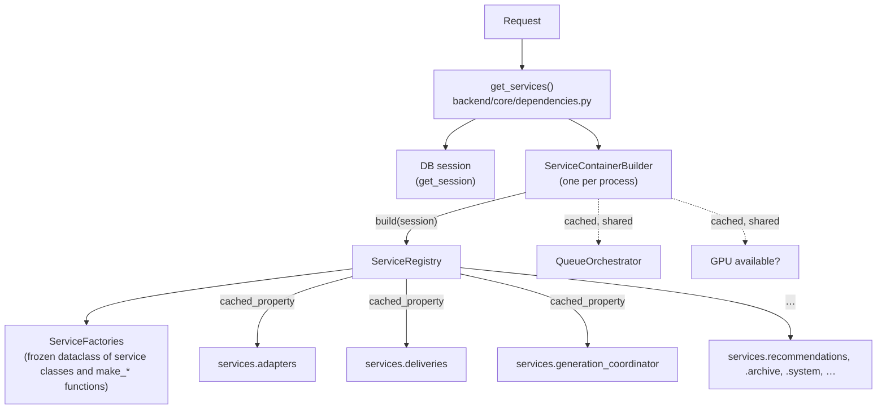

# Backend

[← Wiki home](README.md)

FastAPI, SQLModel and Alembic on Python 3.11, with Redis/RQ for background
jobs. This page is a map; the job machinery has its own page,
[Generation pipeline](Generation-Pipeline.md).

## Package map

| Package | Contents |
| --- | --- |
| [`backend/main.py`](../../backend/main.py) | `create_app()`: CORS, router mounting, lifespan, exception handlers. [`app/main.py`](../../app/main.py) mounts it at `/api` and serves the SPA. |
| [`backend/api/v1/`](../../backend/api/v1) | Routers: `adapters`, `analytics`, `compose`, `dashboard`, `deliveries`, `frontend`, `generation/` (package), `import_export`, `recommendations`, `system`, `websocket`. |
| [`backend/core/`](../../backend/core) | `config.py` (all settings), `database.py` (engine, sessions), `migrations.py` (runs Alembic), `security.py` (`X-API-Key`), `dependencies.py` (`get_services`), `logging.py` (structlog JSON), `gpu.py`. |
| [`backend/models/`](../../backend/models) | SQLModel tables; see [Data model](Data-Model.md). |
| [`backend/schemas/`](../../backend/schemas) | Pydantic request/response models, one module per area. |
| [`backend/services/`](../../backend/services) | `ServiceRegistry`, its builder, and every domain service. |
| [`backend/delivery/`](../../backend/delivery) | Backend plug-ins: `sdnext` generation backend, `http` and `cli` delivery backends, the SDNext HTTP client and image storage. |
| [`backend/workers/`](../../backend/workers) | RQ task functions (`tasks.py`), `DeliveryRunner`, `WorkerContext`. |
| [`backend/migrations/`](../../backend/migrations) | The only Alembic tree. |

### Routers

All routers are mounted under `/v1` in `create_app()`. Most carry
`Depends(get_api_key)`; these do not:

- `dashboard` and `system` (`/v1/dashboard/*`, `/v1/system/status`),
- `frontend` (`/v1/frontend/settings`), because the SPA reads the key from it
  before it can send one,
- the result image route `GET /v1/generation/results/{job_id}/images/{index}`
  ([`generation/images.py`](../../backend/api/v1/generation/images.py)), because
  `` tags cannot send headers,
- the progress WebSocket `/v1/ws/progress`.

The generation router is a package split by concern: `jobs.py` (queue, list,
cancel), `live.py` (blocking generation through the queue, per-job progress,
backends), `results.py`,
`exports.py` and `images.py`. Route modules stay thin and delegate to
`controllers/` (call services) and `presenters/` (shape responses).

The endpoint-by-endpoint reference is [`docs/contract.md`](../contract.md).
The schema side is `create_app().openapi()` itself: `npm run generate:api-types`
exports it without a server (`scripts/export_openapi.py`) and generates the
frontend types from it ([api-type-generation.md](../api-type-generation.md)).

## Handlers and the event loop

Blocking work (database, files, model loading) never runs on the event loop:

- A handler that only does synchronous work is a plain `def`; FastAPI runs it
  in its threadpool.
- An `async def` handler must actually await something, and runs its
  synchronous steps through `run_in_threadpool` (see
  [`generation/controllers/jobs.py`](../../backend/api/v1/generation/controllers/jobs.py)).
  Services use `asyncio.to_thread` instead.

[`tests/api/test_route_handlers.py`](../../tests/api/test_route_handlers.py)
fails on an `async def` handler that never awaits.

## The service container

There is one container, [`ServiceRegistry`](../../backend/services/service_registry.py).



- **Registry**: holds one database session and exposes every service as a
  lazily built `cached_property`: `storage`, `adapters`, `compose`,
  `generation`, `analytics`, `recommendations`, `recommendation_jobs`,
  `archive`, `backups`, `deliveries`, `websocket`, `system`,
  `generation_coordinator`. A service that needs a missing collaborator (no
  session, no queue orchestrator) raises when it is first requested, not when
  the registry is built.
- **Factories**: each property calls one field of the frozen
  `ServiceFactories` dataclass. A default is the service class itself when
  the registry's arguments map straight onto its constructor, otherwise a
  `make_*` function in
  [`service_registry.py`](../../backend/services/service_registry.py). The
  `websocket` default is `get_websocket_service`, which returns the
  process-wide `WebSocketService`.
- **Builder**: [`ServiceContainerBuilder`](../../backend/services/service_container_builder.py)
  builds registries. `get_service_container_builder()`
  ([`backend/services/__init__.py`](../../backend/services/__init__.py)) returns
  one process-wide builder, so the queue orchestrator and the GPU probe are
  created once and shared by every request and worker.
- **Routers** take `services: ServiceRegistry = Depends(get_services)`.
- **Workers** build registries through `WorkerContext.create_service_container`
  ([`backend/workers/context.py`](../../backend/workers/context.py)), which uses
  the same builder.

Always get a service from a registry. Instantiating one directly skips the
locking and cache invalidation that protect long-running workers.

### Overriding services in tests

Either override the FastAPI dependency:

```python
app.dependency_overrides[get_services] = lambda: my_registry
```

or swap factories inside the test-only scope:

```python
from dataclasses import replace
from backend.services import get_service_container_builder, service_container_builder_scope

builder = get_service_container_builder().with_overrides(
    factories=lambda f: replace(f, delivery=my_delivery_factory)
)
with service_container_builder_scope(builder):
    ...
```

`service_container_builder_scope()` stores the override in a `ContextVar`, so
it never leaks across async tasks. It exists only for tests and scripts.

## Services worth knowing

| Service | Module | Notes |
| --- | --- | --- |
| `AdapterService` | `services/adapters/` | CRUD, search, tags, activation/ordinals, bulk actions, statistics. |
| `ComposeService` | `services/composition.py` | Builds a prompt from the active adapters as `<lora:NAME:weight>` tokens, which SDNext resolves against file names. |
| `DeliveryService` | `services/deliveries.py` | Job rows: create, schedule, `claim_job` / `finish_job` / `cancel_job`, results, ratings and favourites, archives and downloads. |
| `GenerationService` | `services/generation/__init__.py` | Talks to a generation backend: progress, interrupt, validate params. Generation itself only runs in the delivery runner. |
| `GenerationCoordinator` | same module | Ties deliveries and generation together: schedule, wait for a job to finish (blocking routes), serialise, cancel (with the backend interrupt). |
| `WebSocketService` | `services/websocket/` | Connection manager and subscriptions. Module-global instance. The lifespan-owned `JobProgressMonitor` (same package) broadcasts through its manager; see [Generation pipeline](Generation-Pipeline.md#live-progress-over-websocket). |
| `SystemService` | `services/system.py` | `/system/status` payload: queue counts, SDNext and importer health, thresholds. |
| `AnalyticsService` | `services/analytics/` | KPIs, time series and insights from delivery history (via `AnalyticsRepository`). |
| `ArchiveService`, `BackupService` | `services/archive/` | Export planning and streaming, import execution, backups. See [Library import](Library-Import.md). |
| `RecommendationService`, `EmbeddingService`, `RecommendationJobService` | `services/recommendations/`, `services/recommendation_jobs.py` | See [Recommendations](Recommendations.md). |
| `StorageService` | `services/storage.py` | Validates and inspects adapter file paths (existence, size, staying inside allowed roots). |

## Delivery and generation backends

[`backend/delivery/`](../../backend/delivery) holds a `DeliveryRegistry` with two
kinds of plug-in:

- **Generation backends** (`GenerationBackend`: `generate_image`,
  `check_progress`, `interrupt`, `is_available`). One is registered: `sdnext`
  ([`sdnext.py`](../../backend/delivery/sdnext.py)), built from an
  `SDNextSession` over a shared `DeliveryHTTPClient` and a
  `FileSystemImageStorage`.
- **Delivery backends** (`DeliveryBackend.deliver`): `http`
  ([`http.py`](../../backend/delivery/http.py)) POSTs `{"prompt": …}` to the
  `host`, `port` and `path` in the job's params; `cli`
  ([`cli.py`](../../backend/delivery/cli.py)) writes the prompt, optionally
  through a `{prompt}` template, to a temporary file on the runner and returns
  its path. Neither runs a command. Used by `POST /v1/deliveries` with a
  non-generation `mode`.

`ensure_delivery_system()` registers them once per process (lifespan and
`WorkerContext.build_default` call it); everything else uses
`get_delivery_registry()`, which runs the same idempotent registration.
`DeliveryHTTPClient` keeps one aiohttp session per event loop, so the shared
SDNext client works from the API loop, the in-process runner loop and RQ
workers.

To add a backend, implement the base class in
[`delivery/base.py`](../../backend/delivery/base.py) and register it in
`_register_builtin_backends`.

## Errors, logging and auth

- Every `HTTPException`, including Starlette's own (the router's 404 and 405),
  becomes an RFC 7807 problem document (`type`, `title`, `status`). A string
  `detail` is the `title`; any other `detail` stays structured in `errors`
  under the status phrase as the title. The exception's headers (`Allow`,
  `WWW-Authenticate`) are kept. Request validation errors (422) still use
  FastAPI's `{"detail": [...]}` body.
- Any other exception is logged with its traceback by the `lora.api` logger and
  returned as a generic 500. **Never return exception text to clients**; it can
  contain paths, SQL or configuration.
- Logging is structlog over stdlib with a JSON renderer (`core/logging.py`).
  Modules call `get_logger(__name__)` and log with `%s` arguments or keyword
  fields; `setup_logging()` runs in the lifespan and when an RQ worker builds
  its `WorkerContext`.
- `get_api_key` (`core/security.py`) compares `X-API-Key` with `API_KEY` when
  one is set. This is a convenience, not security: the key is served to the
  browser. The tool assumes a single user on a trusted LAN; don't build
  features that assume real authentication.

## Configuration

Every runtime setting is a field on `Settings` in
[`backend/core/config.py`](../../backend/core/config.py), read from the
environment. Don't read `os.environ` elsewhere; startup validation and the
`/v1/frontend/settings` payload depend on this being the single source. Full list:
[Configuration](Configuration.md).

Next: [Generation pipeline](Generation-Pipeline.md).
