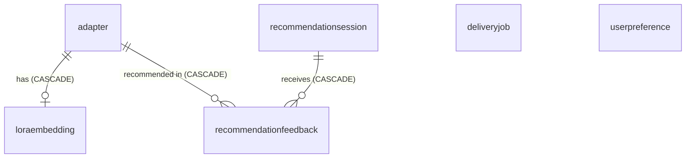

# Data model and migrations

[← Wiki home](README.md)

## Tables

All tables are SQLModel classes in [`backend/models/`](../../backend/models).
Primary keys are UUID strings. Timestamps are `DateTime(timezone=True)` and
default to UTC now. List and dict fields use the portable `JSON` column type so
the same models work on SQLite and PostgreSQL.



### `adapter` ([`adapters.py`](../../backend/models/adapters.py))

One LoRA file and its metadata, mostly imported from Civitai-style JSON
sidecars ([Library import](Library-Import.md)).

| Group | Fields |
| --- | --- |
| Identity | `name`, `version`, `canonical_version_name`, `civitai_model_id`, `civitai_version_id`, `primary_file_sha256` |
| Files | `file_path`, `primary_file_name`, `primary_file_size_kb`, `primary_file_download_url`, `primary_file_local_path`, `preview_image_url` |
| Prompting | `tags`, `trained_words`, `triggers`, `activation_text`, `weight` |
| Composition state | `active`, `ordinal` |
| Classification | `archetype`, `archetype_confidence`, `sd_version`, `nsfw_level`, `supports_generation`, `visibility` |
| Free-form | `description`, `author_username`, `published_at`, `stats`, `extra` |
| Ingestion tracking | `json_file_path`, `json_file_mtime`, `json_file_size`, `last_ingested_at` |

Uniqueness: (`name`, `version`), `primary_file_sha256` and
`civitai_version_id`, so the same file cannot be registered twice under another
label.

### `deliveryjob` ([`deliveries.py`](../../backend/models/deliveries.py))

One queued delivery or generation. `prompt`, `mode` (backend name), `params`
and `result` (JSON text), `status`, `created_at`/`started_at`/`finished_at`,
plus user feedback: `rating` (0–5), `is_favorite` and their update times.
Status semantics are on the [Generation pipeline](Generation-Pipeline.md#status-transitions)
page. Generation history and results are this table; there is no separate
results table.

### Recommendation tables ([`recommendations.py`](../../backend/models/recommendations.py))

- `loraembedding`: per-adapter semantic, artistic and technical embeddings
  (binary), extracted keywords, predicted style, quality/popularity/recency
  scores, normalised triggers and their embeddings. Primary key and foreign key
  is `adapter_id`.
- `recommendationsession`: one recommendation request and what it returned.
- `recommendationfeedback`: explicit or implicit feedback on a recommended
  adapter within a session.
- `userpreference`: learned preferences (`preference_type`, `preference_value`,
  `confidence`, evidence count).

## Migrations

- [`backend/migrations`](../../backend/migrations) is the only Alembic tree,
  configured by the root [`alembic.ini`](../../alembic.ini). Revisions are
  numbered: `0001_initial_schema` … `0004_add_adapter_file_identity`.
- The app migrates on startup: `init_db()` → `run_database_migrations()`
  ([`backend/core/migrations.py`](../../backend/core/migrations.py)) upgrades to
  `head`. Nothing calls `create_all`.
- `env.py` takes the URL from `DATABASE_URL`, falling back to the app's engine
  (SQLite `db.sqlite`), and compares against `SQLModel.metadata`.
- In Docker, the worker waits for the API to be healthy so migrations have run
  before it touches the database.

### Adding a schema change

1. Change the model in `backend/models/`.
2. Create a revision in `backend/migrations/versions/`, following the numbering:

   ```bash
   alembic revision --autogenerate -m "add foo to adapter" --rev-id 0005_add_foo_to_adapter
   ```

   Read the generated file. Autogenerate misses some things (renames, server
   defaults, data migrations) and SQLite needs batch operations for most
   `ALTER`s.
3. Check it against an empty database:

   ```bash
   DATABASE_URL=sqlite:////tmp/check.sqlite alembic upgrade head
   DATABASE_URL=sqlite:////tmp/check.sqlite alembic check
   ```

   `alembic check` must report no differences between the models and the
   migrated schema. Repeat against PostgreSQL if the change uses
   PostgreSQL-specific types (the dev stack's `db` service works).
4. Run `pytest`.

### Version constraints

`sqlmodel` is held below 0.0.45 in `requirements.in`. Newer releases require
timezone-aware datetimes everywhere and `TIMESTAMPTZ` columns, which needs its
own migration. Don't bump it as part of an unrelated change.

## Sessions

- Request code gets a session through `Depends(get_session)` (inside
  `get_services`); one registry, one session.
- Workers and background code use `with get_session_context() as session:`
  ([`backend/core/database.py`](../../backend/core/database.py)) and build a
  registry from it.
- SQLite engines use `check_same_thread=False` and a `NullPool`.

Next: [Frontend](Frontend.md).
