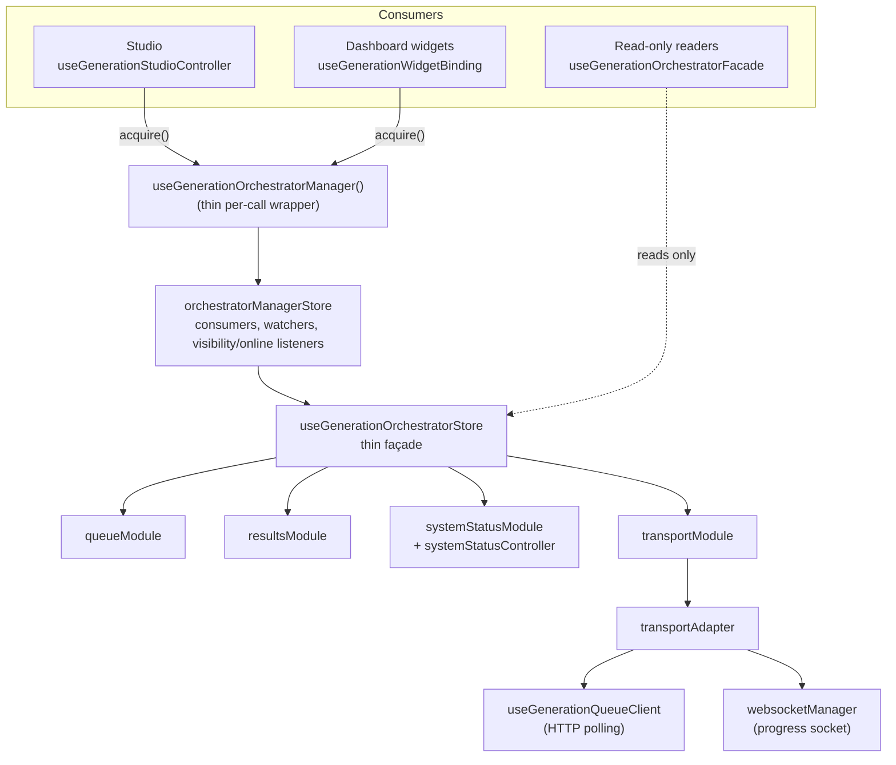

# Frontend

[← Wiki home](README.md)

A Vue 3 + TypeScript SPA built with Vite, using Pinia for state, Vue Router for
navigation, Zod for response validation and Tailwind for styling. Source lives
in [`app/frontend/src`](../../app/frontend/src). Vite's root is `app/frontend`
and `npm run build` writes the bundle to `app/dist/`.
[`app/main.py`](../../app/main.py) serves a built SPA from `dist/` at the
repository root; see [Troubleshooting](Troubleshooting.md#the-built-spa-is-not-served).

## Layout

```
app/frontend/src/
  main.ts              Bootstrap: Pinia, router, load /frontend/settings, mount
  App.vue              Shell (layout, notifications, dialogs)
  router/index.ts      Routes, all lazily loaded
  views/               Route-level pages that assemble feature packages
  features/<name>/     Self-contained feature packages (see below)
  components/          Cross-feature UI: layout, dashboard cards, shared widgets
  composables/shared/  useApi, usePolling, useAsyncResource, useNotifications, …
  services/shared/http HTTP client (the only way to make requests)
  stores/              App-wide stores: settings, app, adminMetrics
  schemas/             Zod schemas shared across features
  types/               Shared TypeScript types (types/generated from OpenAPI)
  config/              Runtime config, navigation, backend settings
  utils/               Generic helpers (freezeDeep, formatting, status, …)
```

### Routes

| Path | View | Feature |
| --- | --- | --- |
| `/` | `DashboardView` | Dashboard cards, generation widgets (lazy) |
| `/loras`, `/loras/:id` | `LorasView`, `LoraDetailView` | `lora` |
| `/recommendations` | `RecommendationsView` | `recommendations` |
| `/compose` | `ComposeView` | `prompt-composer` |
| `/generate` | `GenerateView` | `generation` (the Studio) |
| `/history` | `HistoryView` | `history` |
| `/import-export` | `ImportExportView` | `import-export` |
| `/admin` | `AdminView` | system status, admin metrics |
| `/analytics` | `PerformanceAnalyticsPage` | `analytics` |
| `/offline` | `OfflineView` | — |

### Feature packages

| Feature | What it owns |
| --- | --- |
| `generation` | The Studio (form, queue, results), the orchestrator stores, transport (polling + WebSocket), system status, dashboard widgets |
| `lora` | Adapter gallery (virtualised), detail page, the adapter catalog store |
| `recommendations` | Similar-LoRA and prompt recommendations UI |
| `prompt-composer` | Compose view: pick active adapters, build a prompt |
| `history` | Generation history, ratings and favourites, result export |
| `import-export` | Export, import, backups UI |
| `analytics` | Performance KPIs, charts and insights |

## Feature boundaries

Other code imports a feature only through `features/<name>/public` (a
`public.ts` file or a `public/` folder). Inside a feature, import freely.

This is enforced twice: ESLint's `no-restricted-imports` rules
([`.eslintrc.cjs`](../../.eslintrc.cjs)) and the `ci:check` guardrails
([`scripts/ci_check.py`](../../scripts/ci_check.py)), whose fixtures in
`tests/guardrails/` must keep failing lint. If you need something internal,
widen the feature's `public.ts` deliberately. Generation stores are also
blocked from direct import outside the feature.

## Generation: the orchestrator

The generation feature is the most structured part of the SPA, because several
pages show the same queue and must share one connection. The full module map
is [ADR 007](../architecture/adr-generation-orchestrator-thin-facade.md) and its
2026-10-15 amendments; here is the shape.



The rules that matter in practice:

- **Acquire, then release.** Get a binding with
  `useGenerationOrchestratorManager().acquire(...)`. The binding carries every
  command; `release()` is its only teardown and is idempotent. After release,
  async commands reject and sync commands do nothing, so a stale binding can't
  restart the orchestrator. Never create orchestrator instances in components.
- **One lifecycle, shared.** The manager store starts transport, watchers and
  listeners on the first `acquire()` from any call site and stops them when the
  last consumer releases.
- **Reading is free.** `useGenerationOrchestratorFacade()` returns frozen
  snapshots and registers no consumer; reading it starts nothing.
- **Widgets.** Dashboard widgets that need live data call
  `useGenerationWidgetBinding(label)`, which acquires on mount (no
  history/backend sync, notifications logged rather than toasted) and releases
  on unmount. They must not import the Studio composables; the dashboard loads
  widgets from `@/features/generation/public/widgets` so the Studio bundle
  stays out (`npm run check:bundle` checks this).
- **Immutable snapshots.** Store state is frozen with `freezeDeep` and throws
  on mutation in every build.

Related contracts: [orchestrator store](../frontend/generation-orchestrator.md),
[façade](../frontend/generation-orchestrator-facade.md),
[effect scope ownership](../frontend/effect-scope-ownership-playbook.md),
[acceptance checklist](../frontend/generation-architecture-acceptance.md).

### Transport

- `stores/orchestrator/transportAdapter.ts` combines HTTP queue polling and the
  progress WebSocket behind one object. Creating it starts nothing; it starts in
  `initialize()`/`resume()` and stops in `pause()`/`clear()`.
- `stores/orchestrator/transportModule.ts` holds transport state and commands
  and routes adapter callbacks into the store.
- Polling intervals come from `config/polling.ts`, which reads the
  `generationPolling` block of `/frontend/settings`
  (`GENERATION_*_INTERVAL_MS` on the backend).
- `/system/status` has exactly one poller per backend,
  `stores/systemStatusController.ts`, shared by the Studio and the dashboard
  card.
- WebSocket message shapes are parsed in `services/websocketMessages.ts` and
  pinned by the contract fixture described in
  [Generation pipeline](Generation-Pipeline.md#live-progress-over-websocket).

Extend these rather than adding polling to a component.

## Polling anywhere else

Every other interval poller (admin metrics, analytics auto-refresh, the status
controller) runs on [`composables/shared/usePolling.ts`](../../app/frontend/src/composables/shared/usePolling.ts).
It pauses while the page is hidden or offline and runs once on resume. Its
listeners exist only between `start()` and `stop()`, so the owner must call
`stop()`. Don't use a bare `setInterval`.

## HTTP

All requests go through [`services/shared/http`](../../app/frontend/src/services/shared/http/index.ts)
(`performRequest`, `requestJson`, `getJson`, `postJson`, `requestBlob`,
`createHttpClient`, …) or the reactive wrapper
[`composables/shared/useApi.ts`](../../app/frontend/src/composables/shared/useApi.ts).
They inject the API key and backend URL from the settings store, normalise
401/403/5xx errors, retry only idempotent requests, and never retry aborted
ones. Don't add bespoke `fetch` wrappers.

Validate responses with Zod before they reach a store: shared schemas in
`schemas/`, feature schemas in `*Schemas.ts` files.

## Settings and environment

`main.ts` loads `/frontend/settings` into the settings store
([`stores/settings.ts`](../../app/frontend/src/stores/settings.ts)) before
mounting. It provides `backendUrl`, `backendApiKey` and `generationPolling`.
`getResolvedBackendUrl()` and `getResolvedBackendApiKey()` read it from
anywhere. `VITE_BACKEND_URL` / `VITE_BACKEND_API_KEY` configure the dev server.

## Other shared state

- **Adapter catalog**: `features/lora/stores/adapterCatalog.ts` caches adapter
  summaries for the gallery and recommendations. Read it through
  `useAdapterSummaries` / `useLoraSummaries`.
- **Virtualised gallery**: `features/lora/components/lora-gallery/LoraGalleryGrid.vue`
  uses `vue-virtual-scroller`. Keep breakpoints in sync with container width and
  bulk-mode props, and call `forceUpdate()` after prop-driven size changes.
  Check with 200+ adapters.
- **Job queue mirror**: `useJobQueue` (in `composables/useJobQueueActions.ts`)
  only mirrors the manager's sorted queue.

## API types

`npm run generate:api-types` regenerates TypeScript types from the backend's
OpenAPI schema into `types/generated` ([api-type-generation.md](../api-type-generation.md)).

Next: [Recommendations](Recommendations.md) or [Testing and CI](Testing-and-CI.md).
