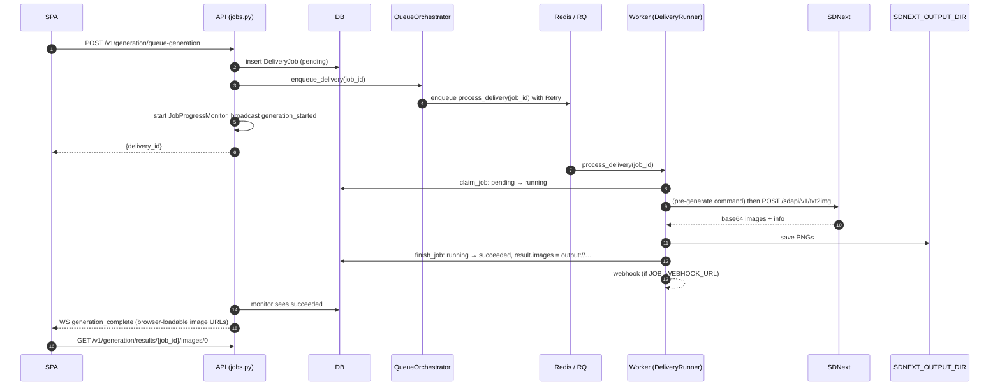
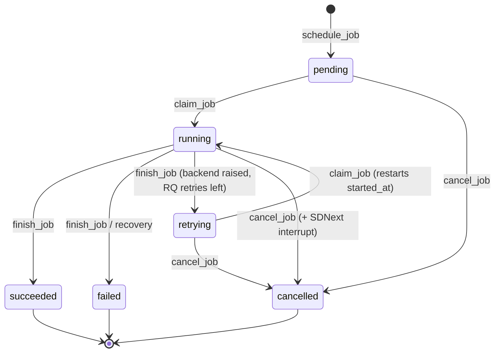

# Generation pipeline

[← Wiki home](README.md)

How a queued generation request becomes PNG files on disk and a `succeeded`
row in the database. This is the most concurrency-sensitive part of the
backend; read it before touching `queue.py`, `deliveries.py`,
`delivery_runner.py`, `job_recovery.py` or the WebSocket monitor.

## Vocabulary

- A **delivery job** is a `DeliveryJob` row ([`backend/models/deliveries.py`](../../backend/models/deliveries.py)).
  A generation job is a delivery job whose `mode` names a generation backend
  (`sdnext`). `params` and `result` are JSON strings.
- A **runner** is whatever executes a job: an RQ worker process, or the
  in-process job runner inside the API.
- To **claim** a job is to move it to `running` with a conditional update; only
  one runner can win.

## The happy path

Step by step, with the code that does it:

1. **Create.** `queue_generation_job` ([`api/v1/generation/jobs.py`](../../backend/api/v1/generation/jobs.py))
   → `GenerationCoordinator.schedule_generation_job`
   ([`services/generation/__init__.py`](../../backend/services/generation/__init__.py))
   → `DeliveryService.schedule_job`, which inserts the row as `pending` and
   enqueues it. `params` stores `generation_params`, `backend`, `mode`,
   `save_images`, `return_format` and an optional `client_ref`.
2. **Enqueue.** `QueueOrchestrator.enqueue_delivery`
   ([`services/queue.py`](../../backend/services/queue.py)) sends the job to
   `RedisQueueBackend` when `REDIS_URL` is set, and to
   `BackgroundTaskQueueBackend` only when it is not. If the Redis enqueue
   raises, the job is **not** moved in-process, where it would run beside the
   RQ worker and recovery would never requeue it: the orchestrator raises
   `QueueUnavailableError`, `DeliveryService.enqueue_job` fails the
   still-pending job, and the API answers 503. Always enqueue through the
   orchestrator so both rules hold.
3. **Monitor.** The handler calls `broadcast_job_started`, which starts a
   `JobProgressMonitor` task in the API process and broadcasts
   `generation_started` to WebSocket subscribers.
4. **Run.** The RQ task `backend.workers.tasks.process_delivery`
   ([`workers/tasks.py`](../../backend/workers/tasks.py)) calls
   `DeliveryRunner.process_delivery_job`
   ([`workers/delivery_runner.py`](../../backend/workers/delivery_runner.py)),
   which claims the job, picks the backend from `params.backend` or `mode`, and
   calls `SDNextGenerationBackend.generate_image`
   ([`delivery/sdnext.py`](../../backend/delivery/sdnext.py)). That runs
   `SDNEXT_PRE_GENERATE_COMMAND` if set, submits txt2img, validates the
   response and persists the images.
5. **Finish.** The runner records the outcome with `finish_job` and, for
   `succeeded`/`failed`, sends the job-finished webhook
   ([`services/job_webhooks.py`](../../backend/services/job_webhooks.py)).
6. **Report.** The monitor reads the persisted status, broadcasts
   `generation_complete`, and stops. Polling clients see the same through
   `GET /v1/generation/jobs/active` and `/jobs/{id}`.

## Status transitions

All transitions go through three `DeliveryService` methods
([`services/deliveries.py`](../../backend/services/deliveries.py)), each a
single conditional `UPDATE … WHERE status IN (…)` via
`DeliveryJobRepository.transition_job_status`:

| Method | From | To | Returns `None` when |
| --- | --- | --- | --- |
| `claim_job` | `pending`, `retrying` | `running` | Job is missing, cancelled, finished or already claimed. The runner then skips it, which is what makes re-enqueueing safe. |
| `finish_job` | `running` | `succeeded` / `failed` / `retrying` | Job was cancelled or failed by recovery while it ran. The runner deletes the images it just saved and sends no webhook. |
| `cancel_job` | `running`, `pending`, `retrying` | `cancelled` | Job is not active. |

Don't write `status` with `update_job_status` from a runner or the API. The
conditional updates are what stop a runner and a cancel request from both
winning.

The UI sees a normalised vocabulary ([`services/generation/statuses.py`](../../backend/services/generation/statuses.py)):
`pending` → `queued`; `running`, `retrying` → `processing`;
`succeeded` → `completed`; `failed`, `cancelled` → `failed`.

## Retries

Only the Redis queue retries.

- `RedisQueueBackend` enqueues every job with an RQ `Retry(max=DELIVERY_MAX_RETRIES, interval=[…])`.
  Intervals are exponential: retry *n* waits
  `DELIVERY_RETRY_INTERVAL_SECONDS × 2^(n-1)`. Delayed retries need the
  worker's scheduler, hence `rq worker --with-scheduler`.
- A retry happens only when the backend **raises** (network error, crash). A
  generation SDNext reports as failed returns normally and is final.
- The runner reads RQ's `retries_left`. If it is above 0 the job goes to
  `retrying` and the task re-raises so RQ schedules the next attempt, which
  claims it from `retrying`. Otherwise `failed`.
- An RQ job timeout (`JOB_RUNNING_TIMEOUT_SECONDS`) is always final: SDNext may
  still be busy with the job, and another attempt would pile onto it.
- A retry of a job that was cancelled meanwhile, or that a killed attempt left
  `running`, cannot claim it and does nothing; recovery fails the latter.

Don't add retry loops at call sites; the RQ policy is the one retry mechanism.

## Cancelling

`POST /v1/generation/jobs/{id}/cancel` → `GenerationCoordinator.cancel_job`:

1. `DeliveryService.cancel_job` moves the job to `cancelled` from whichever
   active status it had (404 for an unknown job, 400 if it had already
   finished).
2. The WebSocket monitor for the job is stopped.
3. If the job was `running`, `GenerationService.interrupt` calls SDNext's
   `/sdapi/v1/interrupt`. SDNext's interrupt is global: it stops whatever is
   rendering, which is this job because only one runs at a time.
4. When the runner returns, `finish_job` finds the job no longer `running`,
   so the `cancelled` status stands and the saved images are removed.

## Recovery

[`JobRecovery`](../../backend/services/job_recovery.py), started by the
lifespan, handles jobs whose runner died (worker killed, API restarted
mid-job):

- At startup and every `JOB_RECOVERY_INTERVAL_SECONDS` (0 = startup only), jobs
  `running` for longer than `JOB_RUNNING_TIMEOUT_SECONDS` are failed with an
  "interrupted" result and announced through the webhook.
- **Without Redis**, the API was the only runner, so at startup *every*
  `running` job is failed at once, and every `pending`/`retrying` job (which
  lived only in the old process's memory) is requeued through the orchestrator
  onto the in-process runner, behind any new requests.

`JOB_RUNNING_TIMEOUT_SECONDS` defaults to
`SDNEXT_TIMEOUT + SDNEXT_PRE_GENERATE_TIMEOUT + 120` and is also the RQ job
timeout, so the two agree on when a job is lost.

Tests stub `JobRecovery.start` with an autouse fixture in
[`tests/conftest.py`](../../tests/conftest.py).

## The in-process fallback

When there is no Redis, `BackgroundTaskQueueBackend` hands jobs to the
process-wide [`InProcessJobRunner`](../../backend/services/in_process_jobs.py):
one thread with one long-lived event loop, running jobs one at a time in FIFO
order.

- Serial because SDNext renders one job at a time and its progress and
  interrupt endpoints are global.
- One long-lived loop because the shared aiohttp client sessions are bound to
  a loop. Never run in-process jobs from request threads or with a per-job
  `asyncio.run`.
- Services take a `TaskScheduler` (a protocol in `queue.py`), not FastAPI's
  `BackgroundTasks`. Routers still pass `BackgroundTasks`, which fits the
  protocol structurally, but the in-process backend ignores it: request-scoped
  tasks would let jobs overlap.
- No retries; a job whose runner raises is `failed`.
- The lifespan stops the runner on shutdown; waiting jobs are requeued by
  recovery at the next start.

Recommendation jobs (embedding computation, index rebuilds) without Redis run
on the same runner, behind generation jobs. See
[Recommendations](Recommendations.md#background-jobs).

## Result images

- Saved images are never stored as base64. `FileSystemImageStorage`
  ([`delivery/storage.py`](../../backend/delivery/storage.py)) writes PNGs under
  `SDNEXT_OUTPUT_DIR`, and `result.images` stores `output://<relative path>`
  references. For queued jobs `return_format` is otherwise ignored
  (`stored_return_format`), with one exception: a job queued with
  `save_images=false` and `return_format=base64` writes no file, so its result
  keeps the base64 data. For the immediate endpoints (`/generate`,
  `/compose-and-generate`) `return_format` shapes the response.
- API responses and WebSocket messages convert references to browser-loadable
  sources (`backend/utils/images.py`): the keyless
  `GET /v1/generation/results/{job_id}/images/{index}` route for files, a
  `data:` URI for older base64 rows.
- The image route ([`api/v1/generation/images.py`](../../backend/api/v1/generation/images.py))
  only serves files that resolve inside the output directory.
- With Redis, the API and the worker must see the same `SDNEXT_OUTPUT_DIR`; the
  dev stack bind-mounts `./outputs` into both.

## Live progress over WebSocket

`JobProgressMonitor` ([`services/websocket/job_monitor.py`](../../backend/services/websocket/job_monitor.py))
polls every 2 seconds (its `poll_interval` default) and combines two sources:

- the **persisted job** (authoritative for status and completion), and
- SDNext's `/sdapi/v1/progress`, which is process-global and ignores the job
  id. Its value is used only while the persisted status is `running`; a queued
  job reports its stored progress or 0.

Clients send `subscribe` and receive `connected`, `subscription_confirmed`,
`generation_started`, `progress_update` and `generation_complete`, broadcast by the `ConnectionManager` to connections subscribed to
the job (or to all jobs). Their shapes are pinned by
[`tests/fixtures/generation_websocket_contract.json`](../../tests/fixtures/generation_websocket_contract.json),
checked from both sides (`tests/test_websocket_contract.py` and the frontend
`websocketContract.spec.ts`). Regenerate with `UPDATE_WS_CONTRACT=1` only for a
deliberate backend change, then update
`app/frontend/src/features/generation/services/websocketMessages.ts`.

The monitor and the connection manager live in the API process's module
globals, which is the main reason the API runs as a single process. More
background: [WEBSOCKET_IMPLEMENTATION.md](../WEBSOCKET_IMPLEMENTATION.md).

## Job-finished webhook

When `JOB_WEBHOOK_URL` is set, the runner POSTs a small JSON summary
(`event: "generation.finished"`, job id, status, prompt, backend,
`client_ref`, generation params, image count, a `download_path` for succeeded
jobs with images, and an error truncated to 500 characters) after a job ends `succeeded` or
`failed`; recovery does the same for jobs it fails. No image data is included;
receivers fetch the image with the usual `X-API-Key`. The token goes in the
`JOB_WEBHOOK_TOKEN_HEADER` header. See [N8N_INTEGRATION.md](../N8N_INTEGRATION.md).

## Where to change what

| Change | Place |
| --- | --- |
| New generation parameter | `SDNextGenerationParams` in `backend/schemas/generation.py`, the txt2img payload in `delivery/sdnext_client.py`, the frontend form and schema |
| New generation backend | Implement `GenerationBackend` in `backend/delivery/`, register it in `_register_builtin_backends` |
| Different retry behaviour | Settings in `config.py` and `RedisQueueBackend`; not at call sites |
| New job status | Don't, without reading every table on this page; update `statuses.py`, the repository's status sets, the frontend schemas and `AGENTS.md` |

Next: [Data model and migrations](Data-Model.md).
