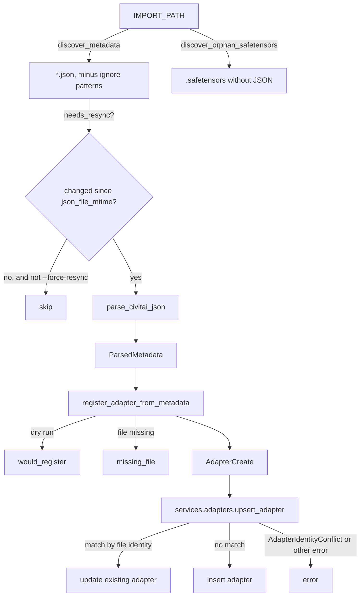

# JSON import flow

[← Wiki home](README.md) · [Library import and archives](Library-Import.md)

Field-by-field reference for how [`scripts/importer.py`](../../scripts/importer.py)
turns a Civitai-style JSON sidecar into an adapter row. The
[Library import](Library-Import.md) page covers how to run the importer.

## Flow



Each JSON file is handled on its own: an error is recorded in the summary
(`status: "error"`) and the scan carries on.

## Parsing (`parse_civitai_json`)

Example input:

```json
{
  "name": "Celestial Anime Portraits",
  "description": "Luminous anime-inspired character portraits",
  "tags": ["anime", "portrait"],
  "creator": { "username": "stargazer" },
  "modelVersions": [{
    "id": 456,
    "modelId": 123,
    "name": "v1.1",
    "publishedAt": "2024-05-01T12:00:00Z",
    "trainedWords": ["celestial portrait"],
    "images": [{ "type": "image", "url": "https://example.com/preview.png" }],
    "files": [{
      "name": "celestial-anime-portraits.safetensors",
      "downloadUrl": "https://example.com/model.safetensors",
      "hashes": { "SHA256": "abc123" },
      "sizeKB": 155000.4,
      "primary": true
    }]
  }],
  "stats": { "downloadCount": 4200, "rating": 4.6 },
  "supportsGeneration": true,
  "sd version": "SD1.5",
  "nsfwLevel": 0,
  "activation text": "celestial portrait"
}
```

| JSON | Adapter field | Notes |
| --- | --- | --- |
| `name` | `name` | Falls back to the JSON file's basename |
| `modelVersions[0].name`, else `version` | `version` | Only the first model version is read |
| `description` | `description` | |
| `creator.username` | `author_username` | |
| `modelVersions[0].publishedAt` | `published_at` | |
| `modelVersions[0].trainedWords` | `trained_words` | |
| `tags` | `tags` | |
| `weight`, else `default_weight` | `weight` | Left to the model default when absent |
| primary file (`primary: true`, else the largest by `sizeKB`) | `primary_file_name`, `primary_file_size_kb`, `primary_file_sha256`, `primary_file_download_url` | `sizeKB` is rounded to an integer |
| `modelId`, `civitai.modelId`, `modelVersions[0].modelId` or top-level `id` | `civitai_model_id` | First one present |
| `civitai.versionId`, else `modelVersions[0].id` | `civitai_version_id` | |
| `preview_image_url`, else the first still image of `modelVersions[0].images` | `preview_image_url` | Videos are skipped |
| `supportsGeneration` | `supports_generation` | Default `false` |
| `sd version` | `sd_version` | |
| `nsfwLevel` | `nsfw_level` | Default `0` |
| `activation text` | `activation_text` | |
| `stats` | `stats` | |
| `archetype` (string) | `archetype` | |
| every other top-level key | `extra` | Kept as JSON |

The importer also records `json_file_path`, `json_file_mtime`,
`json_file_size` and `last_ingested_at`. `None` values are dropped before
building `AdapterCreate`, so model defaults apply to them.

### Model file path

`file_path` is the first that exists of:

1. the primary file's `name`, next to the JSON file;
2. the JSON basename with `.safetensors`, `.pt`, `.bin` or `.ckpt`;
3. otherwise the JSON basename with `.safetensors`, which then fails the
   file check below.

## Registering (`register_adapter_from_metadata`)

- **Dry run** returns `would_register` with the payload and writes nothing.
- The file path is checked with `AdapterService.validate_file_path`; a missing
  or unreadable file returns `missing_file`.
- Otherwise `services.adapters.upsert_adapter` stores it and the result is
  `upserted` with the adapter id. The upsert matches an existing adapter by
  file identity (Civitai version id, then file SHA-256, then the
  `name`/`version` pair) and raises `AdapterIdentityConflict` rather than
  overwrite a different LoRA; see
  [`backend/services/adapters/repository.py`](../../backend/services/adapters/repository.py).

## Change detection (`needs_resync`)

A JSON file is processed when `--force-resync` is set, when no adapter has
that `json_file_path` or it has no `json_file_mtime`, or when the file's
modification time is newer than the stored one. If the check itself fails
the file is processed.

## Summary

`run_one_shot_import` returns `total`, `processed`, `skipped`, `errors`,
per-file `results` and `safetensors_without_metadata` (orphaned model files).
The polling loop (`run_poller`) logs the same events instead; with
`--dry-run` it prints this summary as JSON and exits.
